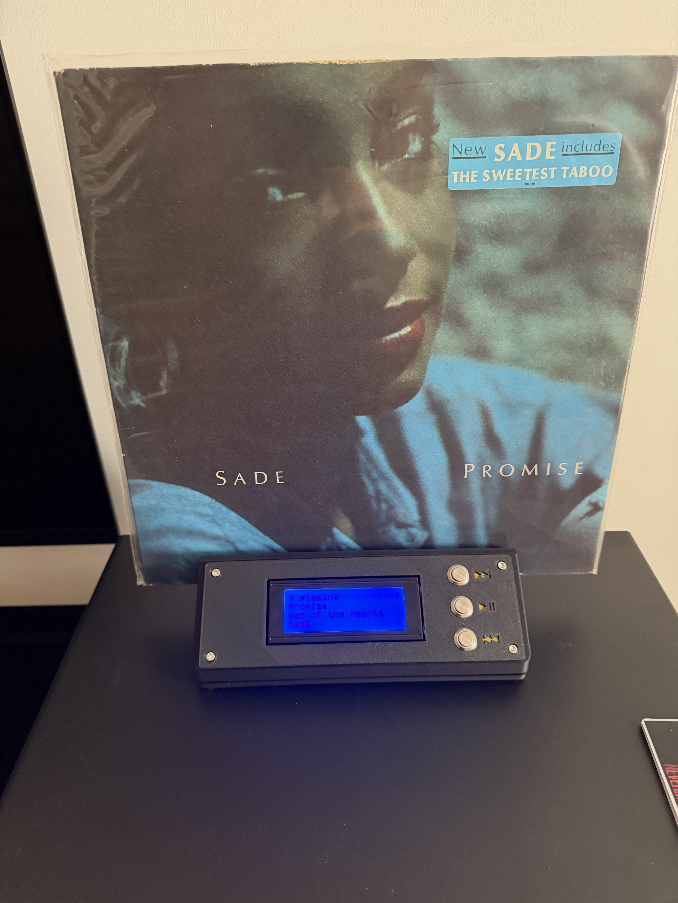

# M-Card

Posez un CD ou un vinyle (équipé d'une carte RFID) sur l'appareil : l'album
se lance sur **Roon**. Boutons physiques ⏮ ⏯ ⏭, écran LCD 20×4 affichant
l'album et le morceau en cours, interface web locale pour les logs, la
configuration et la recherche d'albums dans Roon. Aucune connexion Internet — uniquement le réseau local.

Cahier des charges et croquis d'origine : [versions/idea/](versions/idea/)

**Le prototype 2 en action** (boîtier V0.3, vinyle posé, lecture en cours) :



*Autres photos dans [versions/proto2/](versions/proto2/).*

```
CD/vinyle + carte RFID ──► fente ──► ACR122U ──► Raspberry Pi 3B+ ──► Wi-Fi ──► Roon (Mac)
                                                   │        │
                                              LCD 20×4   3 boutons
```

## Contenu du dépôt

| Dossier | Contenu |
|---|---|
| [`software/`](software/) | application Python (`mcard/`), configs d'exemple, `install.sh`, service systemd, tests |
| [`docs/BOM.md`](docs/BOM.md) | nomenclature — ~15–25 € d'achats, pas de PCB custom |
| [`docs/WIRING.md`](docs/WIRING.md) | câblage complet + [schéma SVG](docs/wiring-diagram.svg) |
| [`docs/SETUP.md`](docs/SETUP.md) | carte SD, installation, appairage Roon, dépannage |
| [`docs/ASSEMBLY.md`](docs/ASSEMBLY.md) | montage dans le boîtier |
| [`enclosure/`](enclosure/) | boîtier 3D paramétrique (OpenSCAD) + STL |

## Démarrage rapide

1. **Commander** les quelques pièces de la [BOM](docs/BOM.md).
2. **Breadboard** : câbler LCD + boutons ([WIRING.md](docs/WIRING.md)),
   brancher l'ACR122U en USB.
3. **Installer** sur le Pi : [SETUP.md](docs/SETUP.md) — `sudo bash install.sh`.
4. **Autoriser** l'extension M-Card dans Roon → Settings → Extensions.
5. Poser une carte inconnue → elle apparaît en `TODO` dans `albums.yaml` →
   chercher l'album sur `http://mcard.local:8088/search` puis « Associer à
   cette carte » (écrit un chemin Roon exact `path: ["Library", "Artists",
   <artiste>, <album>]`). Saisie manuelle d'un `album:` toujours possible via
   `/config` : le titre est alors résolu de façon tolérante (casse, accents,
   ponctuation, « Vol. », mots entiers, plus longue correspondance).
   Tout enregistrement remet `albums.yaml` au format canonique (`path:` sur
   une ligne). Sauvegarde : `curl -fsS
   http://mcard.local:8088/config/albums.yaml/download -o
   backups/albums-$(date +%Y%m%d-%H%M).yaml` (`backups/` est ignoré par git).
6. **Imprimer** le boîtier et assembler ([ASSEMBLY.md](docs/ASSEMBLY.md)).

## Essayer sans matériel (mode simulé)

```bash
cd software && python3 -m venv .venv && ./.venv/bin/pip install flask pyyaml
./.venv/bin/python -m mcard --config <dossier-config> --fake
```

Les cartes se « posent » au clavier, le LCD s'affiche dans le terminal,
Roon est simulé. Tests : `./.venv/bin/python -m pytest tests/`.

## Architecture logicielle

Une queue d'événements unique, un contrôleur central, des threads par
périphérique — chaque composant matériel a un « fake » pour développer sans Pi :

```
nfc_reader (thread) ──┐                        ┌──► roon_client ──► Roon API
buttons    (GPIO)  ───┼──► queue ──► controller ┼──► display ──► LCD I2C
roon callbacks ───────┘                        └──► albums.yaml (ajout TODO auto)
                    webserver (Flask) : état / logs RO / configs RW / recherche Roon
```
