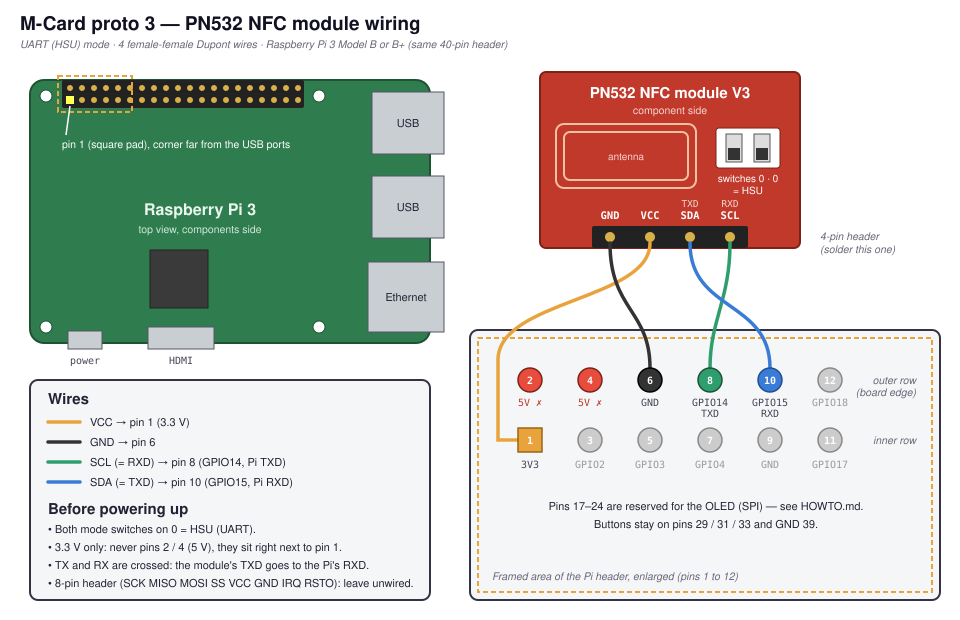

# Prototype 3 — HOWTO

Proto 3 evolves from proto 2 (copied from `../proto2/`). Changes so far:

| | Proto 2 | Proto 3 |
|---|---|---|
| Screen | LCD 2004A, 20×4 characters, blue backlight, I2C | **OLED 3.12" 256×64, white on black**, 16 grey levels, SPI |
| RFID reader | ACR122U board out of its shell (~91 mm wide, USB) | **PN532 NFC module V3** (42.7 × 40.4 mm, UART) |

Status (2026-10-25): **PN532 validated end to end** on a second Pi 3
(`mcard2`): cards read over UART, albums play on Roon (the extension shows
up as "M-Card 0.2", next to the proto 2 device's "M-Card 0.1"). **OLED not
received yet**: its software is tested in `--fake` mode only. Enclosure and the other docs
(`docs/`) still describe proto 2 and will follow once the parts are validated.

## 1. Parts

### Screen: OLED 3.12" 256×64, white, SSD1322

- Ordered: **Audiophonics** ref. 14604, "Écran OLED 3.12" SPI / IIC 256x64
  Blanc", €29.90 incl. VAT, ships from France, header pre-soldered.
- Active area ~76.8 × 19.2 mm: same width as the 2004A's window, less tall,
  but 256 pixels across instead of 20 characters.
- OLED = true black: unlit pixels emit nothing, so "white text on a black
  background" is exactly what a white OLED gives (a "blue background" is an
  LCD backlight, not an OLED option).
- Driven by the Python library `luma.oled` (SSD1322, 4-wire SPI).

**Larger screen, later** — same SSD1322 controller, so the same software
(only the layout would grow):

| Model | Colour | Active area | Price (2026-10) | Notes |
|---|---|---|---|---|
| Newhaven NHD-5.5-25664UCG3 | green (yellow announced) | 136.9 × 35.1 mm | ~€88 shipped (DigiKey) | module 147.2 × 64.15 mm, 3.3 V, SPI by jumpers |
| BuyDisplay ER-OLEDM055-1W | white | 136.9 × 35.1 mm | ~$70 + shipping from China | take the **M** version (breakout board), the bare panel has a 30-pin FPC |

Colour screens were considered and set aside for now:
- 4.58" 320×960 bar IPS (BuyDisplay ER-TFT4.58-1, ~$15): good format, but the
  ST7701S takes pixels over an 18-bit RGB bus = Pi DPI output, ~22 GPIOs and
  a custom kernel overlay.
- 6.86" 480×1280 "PC case" screens: mostly USB-only (proprietary Windows
  software), and too large for the sloped face (module ~189 × 77 mm). Only
  worth it with an HDMI input and a redesigned enclosure.

### RFID reader: PN532 NFC module V3

- Elechouse design, cloned everywhere (often red), ~€5–10; 42.7 × 40.4 ×
  4 mm, antenna on the board, read range ~4–7 cm depending on the tag.
- Same PN532 chip as inside the ACR122U: same cards, **same UIDs**, so
  `albums.yaml` stays valid; `nfcpy` drives it over the serial port.
- No kernel module blacklist needed (unlike the ACR122U).
- If reading through a vinyl sleeve turns out too weak: Elechouse V4
  (6–8 cm).

## 2. Wiring

Everything on the Pi's 40-pin header, female-female Dupont wires. The LCD is
gone, which frees pins 2–6.

### OLED (7 wires, pins 17–24 block)

| OLED pin | Pi pin (physical) | Pi signal |
|---|---|---|
| GND | 20 | GND |
| VCC | 17 | **3.3 V** |
| SCL / SCLK / D0 | 23 | GPIO11 (SPI0 SCLK) |
| SDA / MOSI / D1 | 19 | GPIO10 (SPI0 MOSI) |
| CS | 24 | GPIO8 (SPI0 CE0) |
| DC | 18 | GPIO24 |
| RES / RST | 22 | GPIO25 |

- The module must be in **4-wire SPI** mode (Audiophonics' default; some of
  these boards select the mode with resistors/jumpers on the back: check
  before powering).
- Pins are configurable in `mcard.yaml` (`oled.gpio_dc`, `oled.gpio_rst`).

### PN532 (4 wires, pins 1–10)



Solder the **4-pin header** (GND / VCC / SDA / SCL): I2C and HSU share it,
SDA = TXD and SCL = RXD in HSU mode. The 8-pin header (SCK, MISO, MOSI, SS,
VCC, GND, IRQ, RSTO) is for SPI and stays unused.

| PN532 pin | Pi pin (physical) | Pi signal |
|---|---|---|
| VCC | 1 | **3.3 V** |
| GND | 6 | GND |
| SDA (= TXD) | 10 | GPIO15 (RXD) — crossed |
| SCL (= RXD) | 8 | GPIO14 (TXD) — crossed |

- **Mode switches on HSU (UART)**: both switches at 0/OFF on the Elechouse V3
  (the table is printed on the board: HSU 0-0, I2C 1-0, SPI 0-1). Check them
  on arrival: the first module received was not on 0-0. The mode is read at
  power-on only, so power-cycle after moving them.
- **Power it from 3.3 V**, not 5 V: its signals then stay at the Pi's 3.3 V
  logic level (some listings mention "5 V TTL" levels on the UART — check
  the board you received).

### Buttons: unchanged

GPIO5/6/13 (pins 29/31/33), common GND on pin 39 — see `docs/WIRING.md`.

### Power budget

Pi 3B+ ~1.2 A + OLED (up to ~0.1 A, mostly when many pixels are lit) +
PN532 (~0.1 A while the RF field is on): the same 5 V / 3 A USB-C supply
keeps a large margin.

## 3. Software installation

The proto 3 software lives in `proto3/software/`. **Do not deploy it on the
proto 2 device as is**: its defaults expect the OLED and the PN532 (a
missing SPI screen raises no error, the LCD would just stay blank). To run
it on proto 2 hardware, set `display.type: lcd` and `nfc.device: usb`.

```bash
# from the Mac (repo root)
rsync -a --exclude .venv --exclude __pycache__ proto3/software/ pi@mcard.local:mcard-software/
ssh pi@mcard.local
cd mcard-software && sudo bash install.sh
sudo reboot     # required: UART, SPI and Bluetooth changes
```

`install.sh` now also:
- enables **SPI** (OLED),
- frees the **PL011 UART** on GPIO 14/15 for the PN532: serial console off,
  UART hardware on, `dtoverlay=disable-bt` in `config.txt` (Bluetooth is not
  used; the mini UART is not reliable enough), `hciuart` disabled,
- adds the `mcard` user to the `spi` and `dialout` groups,
- installs `luma.oled`, Pillow, spidev and rpi-lgpio (OLED DC/RST lines).

### Existing `/etc/mcard/mcard.yaml`

`install.sh` never overwrites it. Add the new sections from
`config/mcard.yaml.example`:

```yaml
nfc:
  device: "tty:AMA0:pn532"   # "usb" = ACR122U

display:
  type: oled                 # oled | lcd
  sleep_timeout_s: 120       # replaces lcd.backlight_timeout_s

oled:
  gpio_dc: 24
  gpio_rst: 25
  rotate: 0                  # 2 = panel mounted upside down
  contrast: 180              # 0-255
```

and remove `lcd.backlight_timeout_s` (the log warns about unknown keys).

## 4. Validating the parts (one at a time)

Stop the service while testing: `sudo systemctl stop mcard`.

### PN532 first (simplest)

```bash
ls -l /dev/ttyAMA0                                  # must exist after the reboot
sudo -u mcard /opt/mcard/venv/bin/python -c \
  "import nfc; clf = nfc.ContactlessFrontend('tty:AMA0:pn532'); print(clf); clf.close()"
```

It should print ` on /dev/ttyAMA0` (validated 2026-10-25; nfcpy has no
vendor/product name for a serial reader, hence the bare text). An error
here = see Troubleshooting. `python -m nfc --search-tty` also lists the
readers found on serial ports. Then start the service, place a
few known cards: they must play exactly as before (same UIDs). Try a card in
a vinyl sleeve, bottom corner on the backrest side, to check the range.

### Then the OLED

```bash
ls /dev/spidev0.*                                   # spidev0.0 must exist
sudo -u mcard /opt/mcard/venv/bin/python - <<'EOF'
from luma.core.interface.serial import spi
from luma.core.render import canvas
from luma.oled.device import ssd1322
dev = ssd1322(spi(port=0, device=0, gpio_DC=24, gpio_RST=25))
with canvas(dev) as draw:
    draw.rectangle(dev.bounding_box, outline="white")
    draw.text((10, 25), "Hello M-Card", fill="white")
input("Enter to quit")
EOF
```

Then `sudo systemctl start mcard`: "Place an album" in large type.

## 5. What the OLED displays

- **Now playing**: state icon (▶ ❚❚ ■) + artist on top, **track title in
  large type**, album below. Lines too wide scroll pixel by pixel (2 s pause
  on the start of the text, 30 px/s).
- Accents and typography displayed as-is (bundled **Inter** font, latin
  subset, SIL OFL: `software/mcard/fonts/`). Non-latin scripts (Japanese,
  Cyrillic...) are not in the subset; `oled.font` accepts any TrueType file.
- **Burn-in protection**: the screen switches off after
  `display.sleep_timeout_s` (any card/button wakes it), the picture moves by
  one pixel every 5 minutes, and the default contrast is 180/255.
- **Live preview** on the web console's status page (`/display.png`), also
  in `--fake` mode: the screen can be designed without the hardware.

```bash
cd proto3/software
./.venv/bin/python -m mcard --config <config-dir> --fake   # then open http://localhost:8088/
```

## 6. Troubleshooting

| Symptom | Things to check |
|---|---|
| `TimeoutError: [Errno 110]` from the test above (nothing received) | `mcard` service stopped? Mode switches on 0-0, then power-cycle (validated cause); TX/RX crossed |
| `NFC reader error ... tty:AMA0` in the log | reboot done? `dtoverlay=disable-bt` in `/boot/firmware/config.txt`; serial console off (`raspi-config` → Interface → Serial: login shell **no**, hardware **yes**); TX/RX crossed; switches on HSU |
| Reader found but no card detected | 3.3 V power; card closer to the antenna; try without the sleeve |
| `/dev/spidev0.0` missing | SPI not enabled: `sudo raspi-config nonint do_spi 0`, reboot |
| OLED stays black, no error | module in 4-wire SPI mode? CS on pin 24, DC on 18, RST on 22; `oled.contrast` not 0 |
| Picture upside down | `oled.rotate: 2` |
| Scrolling jerky / high CPU | lower `oled.fps` (default 20) |
