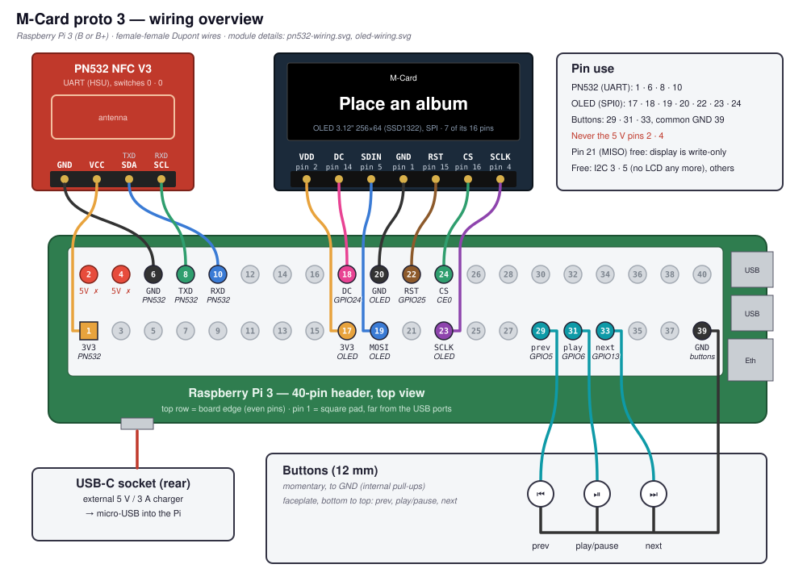

# Wiring — M-Card proto 3

Diagrams:
- overview of the whole Pi header: [`wiring-diagram.svg`](wiring-diagram.svg)
- PN532 module in detail: [`pn532-wiring.svg`](pn532-wiring.svg)
- OLED module in detail (its 2×8 header, seen from the back):
  [`oled-wiring.svg`](oled-wiring.svg)

Everything uses female-female Dupont wires on the Pi's 40-pin header. The
only soldering is the PN532's 4-pin header; the OLED's header comes
pre-soldered. Validated on a Raspberry Pi 3 (PN532 2026-10-25, OLED
2026-11-21); the Pi 3 B and B+ have the same header.

Compared with proto 2, the LCD (I2C, pins 2–6) and the ACR122U (USB) are
gone. To run the proto 3 software on proto 2 hardware, see `../HOWTO.md` §3.



## Overview

```
                   ┌───────────────────────────────────┐
 USB-C charger ────► USB-C socket (rear)               │
                   │      │ micro-USB                  │
                   │  ┌───▼──────────────┐   UART      │ ┌─────────────┐
                   │  │ Raspberry Pi 3   ◄─────────────┼─► PN532 V3    │
                   │  │ (B or B+)        │   4 wires   │ │ behind the  │
                   │  └──┬───────────┬───┘             │ │ slot        │
                   │     │ SPI       │ GPIO            │ └─────────────┘
                   │  ┌──▼───────┐ ┌─▼──────────────┐  │
                   │  │ OLED     │ │ 3 buttons      │  │
                   │  │ 256×64   │ │ prev play next │  │
                   │  └──────────┘ └────────────────┘  │
                   └───────────────────────────────────┘
      Wi-Fi ↔ Roon server (Mac): no other network connection
```

## Pi header map

| Pi pin | Pi signal | Goes to |
|---|---|---|
| 1 | 3.3 V | PN532 VCC |
| 6 | GND | PN532 GND |
| 8 | GPIO14 (UART TXD) | PN532 SCL (= RXD) |
| 10 | GPIO15 (UART RXD) | PN532 SDA (= TXD) |
| 17 | 3.3 V | OLED VDD (screen pin 2) |
| 18 | GPIO24 | OLED D/C (screen pin 14) |
| 19 | GPIO10 (SPI0 MOSI) | OLED SDIN (screen pin 5) |
| 20 | GND | OLED GND (screen pin 1) |
| 22 | GPIO25 | OLED /RST (screen pin 15) |
| 23 | GPIO11 (SPI0 SCLK) | OLED SCLK (screen pin 4) |
| 24 | GPIO8 (SPI0 CE0) | OLED /CS (screen pin 16) |
| 29 | GPIO5 | button prev |
| 31 | GPIO6 | button play/pause |
| 33 | GPIO13 | button next |
| 39 | GND | buttons, common return |

- **Never** use the 5 V pins 2 and 4: both modules run on 3.3 V, and pins 2
  and 4 sit right next to pin 1.
- Pin 21 (SPI0 MISO) stays free: the display is write-only.
- Free for later: the I2C pins 3 and 5 (no longer used since the LCD is
  gone) and every pin not listed above.
- Configurable in `mcard.yaml`: `oled.gpio_dc`, `oled.gpio_rst` and the
  `buttons` section. SPI0, the UART and the button pins are fixed by the
  hardware or by the overlays `install.sh` sets up.

## OLED 3.12" 256×64 (SSD1322, SPI): 7 wires

Detail: [`oled-wiring.svg`](oled-wiring.svg)

The Audiophonics module (ref. 14604) has a **2×8 header with no labels on
the component side**. The pin table comes from the Audiophonics product
page. Pin numbers are printed on the display side only: 15 · 16 at one end,
1 · 2 at the other, **odd pins in the column next to the glass**. The pins
stick out at the back, which is the side the detail diagram shows: from
there, pin 15 is top right and pin 1 bottom right.

| Screen pin | Signal | Pi pin (physical) | Pi signal |
|---|---|---|---|
| 1 | GND | 20 | GND |
| 2 | VDD (3.3–5 V) | 17 | **3.3 V** |
| 4 | SCLK (D0) | 23 | GPIO11 (SPI0 SCLK) |
| 5 | SDIN (D1) | 19 | GPIO10 (SPI0 MOSI) |
| 14 | D/C | 18 | GPIO24 |
| 15 | /RST | 22 | GPIO25 |
| 16 | /CS | 24 | GPIO8 (SPI0 CE0) |
| 3, 6–13 | not connected | | |

- Audiophonics ships it set to **4-wire SPI** (nothing to change). Other
  SSD1322 boards may select the mode with resistors/jumpers on the back.
- **Screen pins 1 (GND) and 2 (VDD) are side by side**: a swap can damage
  the module. Check them twice before powering up.
- Power it from **3.3 V** (pin 17) even though it accepts up to 5 V: the
  Pi's signals are 3.3 V.
- Software: `display.type: oled` (the default), SPI enabled by `install.sh`.

## PN532 NFC module V3 (UART): 4 wires

Detail: [`pn532-wiring.svg`](pn532-wiring.svg)

Solder the **4-pin header** (GND / VCC / SDA / SCL). I2C and HSU (the
PN532's UART mode) share it: in HSU mode, **SDA = TXD and SCL = RXD**. The
8-pin header (SCK, MISO, MOSI, SS, VCC, GND, IRQ, RSTO) is for SPI and
stays unwired.

| PN532 pin | Pi pin (physical) | Pi signal |
|---|---|---|
| VCC | 1 | **3.3 V** |
| GND | 6 | GND |
| SCL (= RXD) | 8 | GPIO14 (TXD) — crossed |
| SDA (= TXD) | 10 | GPIO15 (RXD) — crossed |

- **Both mode switches on 0 = HSU (UART)**. The table is printed on the
  board: HSU 0-0, I2C 1-0, SPI 0-1. The first module received was **not**
  on 0-0 out of the box. The mode is read at power-on only, so power-cycle
  after moving the switches.
- **Power it from 3.3 V**, not 5 V: its signals then stay at the Pi's 3.3 V
  logic level.
- Software: `nfc.device: tty:AMA0:pn532` (the default). `install.sh` frees
  the Pi's main UART for it: serial console off, `dtoverlay=disable-bt`.
- Same PN532 chip as in the ACR122U: same cards, same UIDs.

## Buttons: 6 wires (unchanged from proto 2)

Each momentary button connects a GPIO pin to GND (internal pull-up enabled in
software, press = low level). On the faceplate, from bottom to top:
⏮ prev, ⏯ play/pause (toggle), ⏭ next.

| Button | GPIO (BCM) | Pi pin (physical) | Common GND |
|---|---|---|---|
| ⏮ prev | GPIO5 | 29 | 39 |
| ⏯ play/pause | GPIO6 | 31 | 39 |
| ⏭ next | GPIO13 | 33 | 39 |

The 3 GND returns can be daisy-chained and brought back to pin 39 with a
single wire (or spread over pins 30/34/39).

The pins are deliberately adjacent (29→33, on the inner row of the header)
and away from the SPI and UART pins: clean, readable wiring.

## Power

- Panel-mount female USB-C socket in the rear wall → micro-USB cable to the
  Pi's power input. From the outside, only a USB-C port is visible.
- 5 V / 3 A charger recommended: Pi 3 B+ ~1.2 A + OLED (up to ~0.1 A,
  mostly when many pixels are lit) + PN532 (~0.1 A while the RF field is
  on). Both modules draw from the Pi's 3.3 V pins.

## Bring-up order

One part at a time, with the `mcard` service stopped (commands in
`../HOWTO.md` §4):

1. Install the software (`sudo bash install.sh`) and **reboot**: it enables
   SPI and frees the UART.
2. Wire the PN532 (switches on 0-0) and run the PN532 test: it must answer
   ` on /dev/ttyAMA0`.
3. Wire the OLED and run the luma test: a white frame with "Hello M-Card".
4. Wire the buttons.
5. Start the service: "Place an album" on the screen; known card → Roon
   playback; unknown card → TODO entry; buttons → transport.
6. Only then take it apart and integrate it into the enclosure
   (ASSEMBLY.md, still proto 2: to be updated with the proto 3 enclosure).
