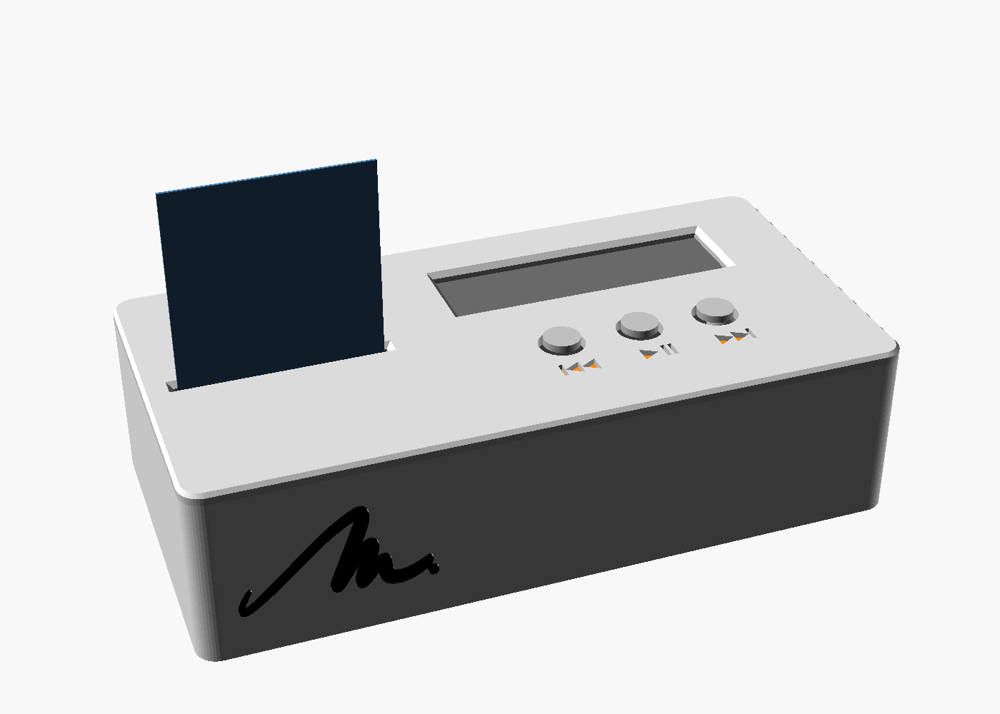

# M-Card enclosure — proto 3 (V1.0, first draft)

Parametric model: [`mcard.scad`](mcard.scad) (all dimensions at the top of the
file). Pre-generated STLs in [`stl/`](stl/). Drawn from Eric's sketch
(2026-11-22); not printed yet. The proto 2 enclosure is archived in
[`../../proto2/enclosure/`](../../proto2/enclosure/).



Views: [front](view_front.png) · [back](view_back.png) ·
[exploded](view_exploded.png) · [cover from below](view_cover_under.png) ·
[dimension drawing](drawing.svg) (top view + section through the slot)

## Design

A flat **190 × 96 × 50 mm** box (proto 2: 210 × 150 plus a console):

- **Card slot** on the left of the top: the card (ISO 85.6 × 54) stands in
  portrait, **32 mm deep**, facing the front; 53.6 mm of it shows.
- **PN532 reader** standing inside, just behind the card and parallel to it
  (antenna ~3 mm from the card). It is 40.4 mm tall, so it fits only that
  way up, and it sets the height: 50 mm total, 43 mm inside. Its 4-pin
  right-angle header points toward the screen: the Dupont plugs stick out
  sideways, between the board and the Pi's USB block.
- **OLED 3.12"** at the back right of the top, behind a window the size of
  its visible area (chamfered for the viewing angle). Screen and buttons
  are centered in the space right of the card.
- **3 buttons** ⏮ ⏯ ⏭ in a row in front of the screen, same design as proto
  2: 12 mm panel buttons, **cut-through** icons over a contrasting plate.
- **"M." logo** inlaid in the front face, under the card: a pocket in the
  wall plus the letters printed in another color and glued in (1 mm proud).
- **Rear USB-C** power socket, as on proto 2.

**Two main parts.** The **tray** is the floor and the walls (Raspberry Pi
posts, USB-C, logo pocket, vents). The **cover** is the whole top: slot,
reader bay, OLED posts, buttons, icons. Everything that has wires sits on
the cover. Wire it on the bench, plug the wires into the Pi, lower the cover
onto the tray: 4 screws from below, none visible.

The cover serves as the requested "screen + buttons plate". A separate plate
would either sit proud of the top (the box would no longer be 50 mm) or rest
on ledges that cannot print without supports. Making the whole top the plate
avoids both.

Inside, the Raspberry Pi lies flat under the screen and buttons, turned
180°: USB/Ethernet to the left (unused), GPIO header along the front,
micro-USB power at the back, near the USB-C socket. The model holds dummy
components and keep-out volumes (Dupont plugs, wire bends, button bodies,
OLED header). They were checked for collisions with the parts and with each
other.

## Parts

| Part | Print orientation | Role |
|---|---|---|
| `tray` | floor on the bed | floor + walls, 4 Pi posts, vents, rear USB-C, logo pocket, counterbored cover screws |
| `cover` | **upside down** (top face on the bed) | the whole top: slot + channel, reader bay (backplate, side stops, ledge), OLED window + 4 posts, 3 button holes, cut-through icons + recess, 4 long screw bosses, alignment rim |
| `icon_plate` | flat, **contrasting color** | glued into the recess under the icons: its color shows through them |
| `logo` | flat, **contrasting color**, visible face up | the "M." letters (two pieces: the stroke and the dot), glued into the front pocket |

PLA (or PETG), 0.4 nozzle, 0.2 mm layers, 3 perimeters, 15 % infill, **no
supports**. Bed: 190 × 96 mm.

## Mounting the components (on the cover)

- **PN532** (red V3 board, 42.7 × 40.4, 4-pin right-angle header on a
  40.4 mm edge): flat (solder) side against the slot's back wall, on 1 mm
  double-sided foam tape, between the two side stops, resting on the
  ledge. **Header toward the screen, DIP switch down**: the four plugs go
  through the cut-out in the right stop. Trim the header's pin tails on the
  flat side to 1 mm or less (they face the back wall), and keep the tape
  off them. The plugs leave ~7 mm before the Pi's USB block: bend the wires
  up there.
- **OLED**: glass up against the window, on 4 posts, with 4 × M2.5×5 screws
  through the module's holes, tapped into the PLA (M2.5×6 with a washer).
  If the picture comes out upside down: `oled.rotate: 2` in `mcard.yaml`.
- **Buttons**: through the 3 mm top, nut underneath.

## Threaded inserts and screws

- **4 M3 inserts** (Hangtife M3×5×4, same as proto 2), pressed into the
  bottom end of the cover's 4 long bosses.
- **4 × M3×8** socket head: tray floor (counterbored) → cover bosses.
- **4 × M2.5×6**: Raspberry Pi → floor posts.
- **4 × M2.5×5**: OLED → cover posts.
- **2 × M2**: USB-C socket.

## To check before printing

1. **The PN532 board**: measured on Eric's module from a photo (size,
   header edge, header 22 mm ± 1 below the top edge as mounted: `hdr_z`).
   The right stop's cut-out leaves 3 mm on each side of the plugs.
2. **The cards**: the reader only sees the card's bottom 32 mm. Tested OK
   (2026-11-22) with Eric's cards: full-size antenna. A tag sticker stuck
   high up on a card would not be read.
3. **OLED hole size** (M2.5 assumed) and the **USB-C socket** cut-out
   (`usbc_*`, same as proto 2).
4. **The slot width** (`slot_gap` = 2.0 nominal, ~1.7 printed for a 0.76 mm
   card): print a short test piece if your printer runs tight.

## Regenerating

```bash
./render.sh     # STLs, PNG views and drawing.svg (OpenSCAD at /opt/homebrew/bin)
```

`part="assembly"` (or `"exploded"`) in the OpenSCAD GUI shows the overall
view. `logo.scad` is generated: `python3 tools/trace_logo.py
../../marketing/build/img/logo-m.png logo.scad` (Pillow needed). The
dimensions written on `drawing.svg` are typed into
`tools/compose_drawing.py`: update them when the parameters change.
